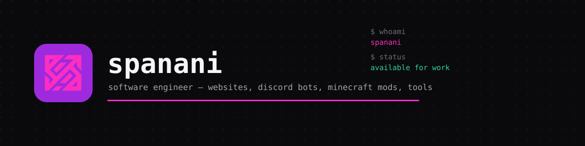

  

  

    
    
    
    
  

## About

I'm spanani — a solo software engineer. I design, write, and ship
everything myself: websites, Discord bots, Minecraft mods and plugins,
Discord server setups, and the small precise tools in between. No
agency layers, no account managers — you talk to the person actually
writing the code.

This repo is both my portfolio and the site itself: [spanani.de](https://spanani.de)
is a fully static build — plain HTML, CSS, and vanilla JavaScript, no
framework, no build step — deployed on GitHub Pages from `main`, with
`spanani.de` set as the custom domain via `CNAME`. The one exception to
"no backend" is `/pausenklau`, whose accounts run on a small Cloudflare
Worker (see below).

**Looking to hire me?** → [spanani.de/services](https://spanani.de/services) · [spanani.de/contact](https://spanani.de/contact)

## Structure

| Page | What's there |
|---|---|
| `/` | Homepage — name-first hero with a code snippet, a grid of what I build, featured projects, and a way to get in touch. |
| `/projects` | Every side project in one place: Bauchgefühl, Pausenklau, the clock, the Rust raid calculator, the tennis tracker, and Rust Empire. |
| `/services` | What I take on for other people: Discord bots, Minecraft mods/plugins, server setup, websites, custom tools. No prices listed — every project's different, message me and we'll figure it out. |
| `/contact` | Discord and email, both click-to-copy. No contact form, because there's nothing behind it to send one to. |
| `/impressum`, `/datenschutz` | The German legal pages a site like this needs. |
| `/clock` | A network-synced clock: digital and analog dial, a 3D-globe world clock, a stopwatch, a timer, settings that stick via `localStorage`. |
| `/rust` | A raid calculator for the game Rust: pick walls, doors and deployables, choose which explosives you can use, and get the cheapest raid path (mixed combos included) with sulfur, gunpowder and every raw material. |
| `/tennis` | An offline-first match tracker built mobile-first. |
| `/rustempire` | A separate Rust server-management tool, kept in its own corner of this repo. |
| `/pausenklau` | A school tool with accounts: upload a photo of your timetable (A/B weeks supported), it gets read in automatically, then you track how far each teacher runs over or stops early. Live countdown to the bell on network time, school holidays for every German state, a leaderboard, sync across devices. |

## Design

Black, white, one purple accent. Dark by default, flips to light
if your system asks for it. No gradients, no animated backgrounds —
the only visual flourish on the homepage is a static code snippet,
because that's what actually proves I can build something.

`/rust` and `/tennis` run their own independent color systems and
aren't affected by any of this.

**Fonts:** DM Mono for the homepage headline and anything that's
actually data (timestamps, digits, labels), Space Grotesk for every
other heading, Inter for body copy. All self-hosted under
`/assets/fonts` — no Google Fonts, no third-party font requests.
Licensed under the SIL Open Font License 1.1 (`assets/fonts/OFL.txt`).

## Notes

- Apart from `/pausenklau`, there is no backend and no forms that go
  anywhere — everything you see is exactly what gets served.
- `/pausenklau` talks to `workers/pausenklau-api`: a Cloudflare Worker
  with a D1 database (accounts with salted PBKDF2 password hashes,
  hashed session tokens, timetable and entries) and Workers AI
  (GLM-5.3 Flash, low reasoning effort) for reading timetable photos:
  every lesson comes back with its own start and end time, so days with
  different period or break lengths just work. In a benchmark on real
  screenshots it got 119/120 lessons exactly right; Mistral Small 3.1
  and Llama 4 Scout mixed up days and lengths. Holidays come
  from the [OpenHolidays API](https://openholidaysapi.org). Deploy with
  `npx wrangler deploy` inside `workers/pausenklau-api`; schema changes
  go in `migrations/` (`npx wrangler d1 migrations apply pausenklau-db --remote`).
- `/clock` pings a couple of public time APIs to stay in sync and
  falls back to your device's own clock if none of them respond.
- Settings (clock display, accent color) persist per-browser via
  `localStorage`.
- Don't delete `CNAME` — GitHub Pages needs it to keep serving the
  custom domain.

## License

MIT — see [`LICENSE.txt`](LICENSE.txt). The self-hosted fonts are
licensed separately under the SIL Open Font License 1.1
(`assets/fonts/OFL.txt`), not MIT.
